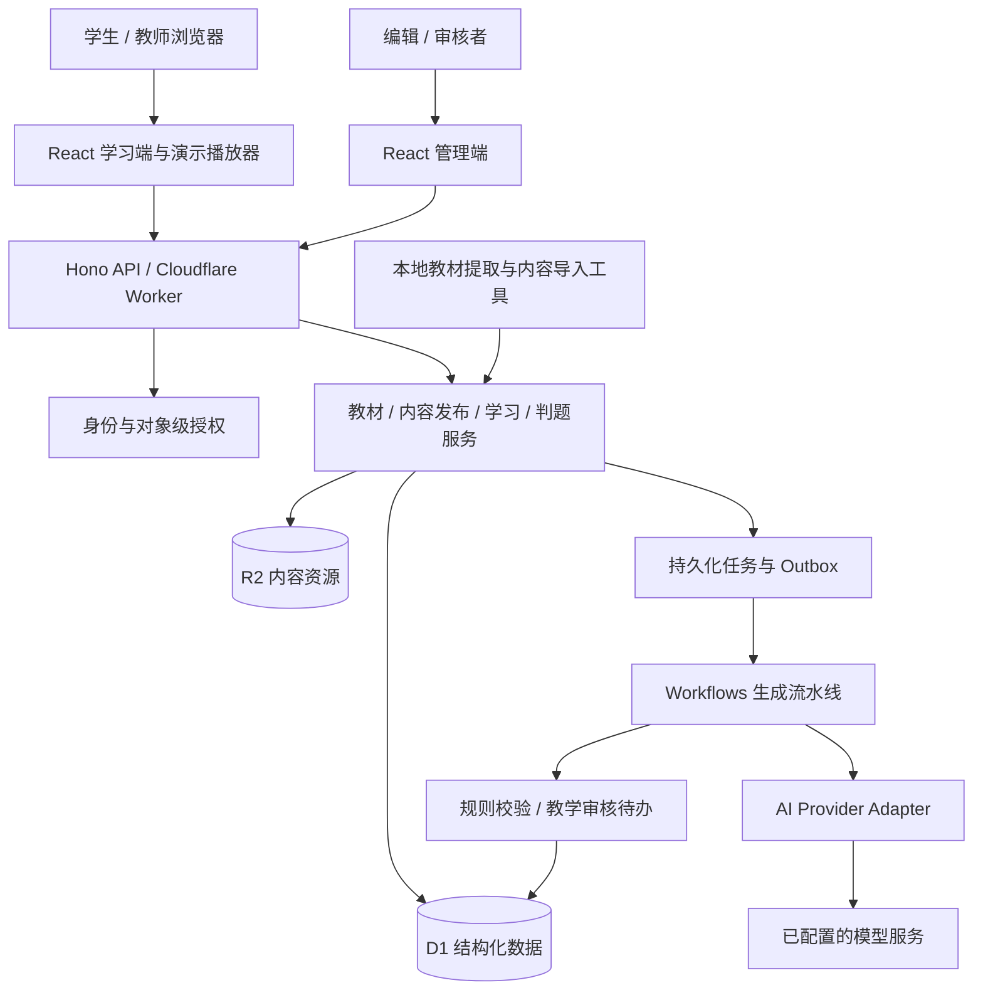

# 数学智能教学平台总体架构

版本：v1.0 · 日期：2026-10-19 · 状态：待实现的技术基线

## 1. 目标与范围

建设以教材为主线的数学学习平台，使学生能够沿教材顺序学习、操作动态教具、独立作答、获取分层提示并复习薄弱内容。教师可进行课堂演示，编辑与审核者可持续生产课程、题库及动画。首期教材依据和内容边界见[教材映射](./04-首期教材与课程映射.md)。

原分析提出的“知识讲解 → 动态演示 → 练习 → AI 辅导 → 学习反馈 → 持续学习”作为整体闭环保留。首期聚焦四年级整数计算、周长面积、数量关系和大数；函数、微积分、复杂几何证明、任意动画代码生成及视频渲染不进入首期依赖。

### 1.1 交付层次

| 层次 | 内容范围 | 系统能力 |
| --- | --- | --- |
| 内测切片 M1 | 第一单元 + 长方形面积代表课 | 教材首页、教学播放器、答题、进度、基础后台和发布 |
| 首期完整 V1 | 本册六单元、四活动、期末复习 | 全册内容、模板集、错题复习、AI 草稿流水线、教材管理 |
| V1.1 | 第二本教材及首期增强 | 实际验证多教材导入、教师组卷与更丰富反馈 |
| 后续 | 其他学段及高级能力 | 特定数学引擎、符号计算、音视频、班级协作 |

M1 的非试点目录可见但标为“建设中”；V1 发布要求全册必修节点可学。平台没有实现时，文档中的数量、性能和工期均是设计目标，不是运行结果。

### 1.2 角色

访客可浏览已发布教材和试听内容；学生查看自身学习记录、答题和提示；教师使用已发布内容的演示模式；编辑创建草稿；审核者审核与发布；管理员管理身份、教材上架、模型和系统配置。首期教师不自动获得学生数据访问权，班级授权关系在后续单独建设。

## 2. 架构原则

1. 教材结构驱动导航，知识结构支撑关联：不以散乱知识文章替代教材课程。
2. 原始资源、结构化内容、学习记录分离：内容可更新，历史学习证据可复现。
3. 浏览器执行数学交互，服务端负责判题与发布权威：客户端展示结果不能作为正式成绩。
4. AI 产生有来源、可验证的草稿；模板实现和判题规则由程序控制。
5. 首期采用模块化单体，边界通过包接口和服务层落实，不提前拆分大量微服务。
6. 所有昂贵任务持久化、可重试、可观察；学生不等待批量生成完成才能学习。

## 3. 总体结构

前端静态文件通过 Workers Static Assets 提供，API 与页面同源。`/api/*` 必须进入 Worker 并接受鉴权；SPA fallback 只用于页面路由，未知 API 返回 JSON 404。Cloudflare 官方提供 React + Vite 集成路径，具体构建产物与绑定在工程初始化时固定并纳入锁文件。[官方 React + Vite 指南](https://developers.cloudflare.com/workers/framework-guides/web-apps/react/)

教材全文提取、OCR 和切图在可信本地工具或独立任务进程执行；不要在 Worker 的普通 HTTP 请求中运行 PDF 原生处理程序。用户提供的教材仅作为输入资源，本文档编写不涉及外部上传或部署。

## 4. 技术选择与取舍

| 层 | 首期选择 | 依据及边界 |
| --- | --- | --- |
| 工程 | TypeScript、pnpm workspace | 共享契约与数学规则；包版本锁定 |
| 前端 | React、Vite、React Router | 教材路由、页面级懒加载、课节学习状态 |
| UI | Tailwind CSS、按需封装 shadcn/ui | 统一控件，学生端使用较大字号和触控面积 |
| 服务端状态 | TanStack Query | 查询缓存按教材、内容发布版本和身份分区 |
| 数学展示 | KaTeX、SVG、HTML | 公式和竖式分开渲染；SVG 教具支持键盘操作 |
| 输入 | 普通表单、结构化竖式、数字键盘 | 小学题型优先；MathLive 仅在后续确有需求时引入 |
| 动画 | 自研确定性状态机 + SVG；普通 UI 可用 CSS/Motion | 不靠动画库计算数学；支持单步与减弱动效 |
| 图形扩展 | 模板渲染适配器 | JSXGraph/Mafs 后续按几何或函数需求接入，不首期双引擎并用 |
| API | Hono + Cloudflare Workers | 轻量请求、业务服务、权限、模型代理 |
| 数据 | D1 + 版本化 SQL 迁移 | 结构化教材、发布清单、练习和学习事件 |
| 对象资源 | R2，源教材与公开素材分桶 | 控制原始文件、预览与公开资源访问 |
| 异步 | Workflows + D1 job/outbox | 首期 AI 内容生成的持久化步骤；无需首期额外引入 Queues |
| 协议校验 | Zod；导出 JSON Schema | 共享类型、请求验证、动画和 AI 输出约束 |
| 验证 | Vitest、Worker 集成测试、Playwright | 数学规则、权限、发布并发与完整学习路径 |
| 可观察性 | 结构化日志与指标 | 内容/请求/任务可追踪，避免记录完整学生对话 |

原分析中的 Cloudflare AI Gateway、Queues、Containers、SymPy、Manim、FFmpeg 作为扩展项。首期整数运算、单位换算和长方形验证在 TypeScript 中完成，不依赖符号计算服务。

## 5. 领域与模块边界

| 领域模块 | 拥有的数据和职责 | 对外能力 |
| --- | --- | --- |
| Identity | 用户、身份绑定、角色、会话 | 验证身份与角色/资源访问 |
| Textbook | 教材系列、版次、源文件、页映射、目录 | 书架、默认教材、目录检索 |
| Content | 课节/题目/解析/场景的修订、来源 | 草稿编辑、版本预览、依赖校验 |
| Publication | 审核记录、发布清单、当前指针 | 原子激活、撤回、回退、内容可见性 |
| Math | 数学领域值、算法、题型判分 | 无 UI 和网络依赖的确定性函数 |
| Animation | 场景协议、模板注册、纯状态转移、渲染 | 可重放的逐步演示和交互快照 |
| Learning | 练习会话、作答、提示、进度、错题 | 个人学习状态及可解释复习建议 |
| AI | 提示词模板、provider、任务、消耗 | 解题/改写/场景草稿与有限即时提示 |
| Operations | 审计、配额、资源权限、反馈 | 后台运营与异常恢复 |

课程内容不得直接查询学生数据；动画引擎不得直接调用模型；Provider Adapter 不决定教学范围；判题器不能依赖前端传入的答案或得分。依赖方向为 UI/API → 应用服务 → 领域规则与仓储接口，Cloudflare 绑定是基础设施实现。

## 6. 教材、内容与发布版本

区分四种身份：

- `textbookId`：同出版社/学科/年级/册次的教材身份，例如苏教版数学四年级上册。
- `editionId`：具体版次，例如本 PDF 所载 2026-07 第 1 版；不能只凭文件名生成。
- `sourceAssetId`：一次源文件修订，由哈希标识；同版扫描更换也可能生成新资源。
- `releaseId`：平台某次已审核内容发布，固定目录、课节、题目、解析、场景和资源版本。

目录节点属于版次。`lessonId` 等稳定内容 ID 属于其教材版次，修订使用不可变 `revisionId`。一个发布清单绑定全部引用的确切修订；知识点和模板可跨教材共享，但不能直接共享未经核对的教材课节。

发布过程：创建清单 → 验证全部引用、范围、资源与审核结论 → 写入不可变清单 → 通过比较当前 `releaseId` 的条件更新切换指针。内容与清单先就绪再切换，读请求一次解析指针，并在后续资源请求中使用同一 release。清单写入失败不影响旧发布；指针更新竞争失败返回 409，不覆盖另一位审核者的结果。

D1 的 `batch` 可将一组语句作为事务顺序执行；项目应利用其全体成功或回滚语义，并结合条件更新检查并发冲突，不能假定跨 D1、R2、Workflow 的分布式事务。[D1 Database API](https://developers.cloudflare.com/d1/worker-api/d1-database/)

旧作答引用旧题目修订与评分规则；新题发布不会重算历史分数。严重错误可停用对应内容并显示纠错通知，重新评分须形成独立审计事件。教材整版下架优先于历史深链访问，按权限提供历史记录或仅元数据，不通过旧版本绕过撤回。

## 7. 三条主要运行链路

### 7.1 学习与作答

浏览器获取首页配置及可见教材 → 解析当前教材版次与发布清单 → 获取课节教学包和公开题干 → 在本地操作教具 → 服务端创建练习会话 → 学生提交答案 → 服务端使用固定题目修订判题 → 同一次数据写入保存作答与学习事件 → 更新可重建的进度投影。

公开练习响应不携带正确答案、隐藏解析、判题表达式或将答案嵌入前端包。示范例题本身可公开解析；二者 DTO 分离。作答提交使用会话签发的题目列表、用户身份与幂等键，拒绝用户替换为其他教材的题目。

### 7.2 内容生产

源文件核验 → 页映射和目录 → 教研划分课节/知识点 → 人工撰写或 AI 生成草稿 → 数学校验与场景预览 → 教材一致性与教学审核 → 发布清单 → 首页与目录可见。自动提取结果只进入草稿。

### 7.3 AI 生成

管理员或编辑提交任务 → 原子创建 `generation_jobs` 与 `outbox` → 派发器用 job ID 创建 Workflow → 读取固定教材与题目修订 → 结构化解答 → 确定性验证 → 教学改写 → 模板场景规划 → Schema/语义/预览校验 → 写入新草稿 → 待人工审核。

Workflow 的步骤重试用于临时网络或服务错误；数学不通过不盲目重复。每步骤以 `(jobId, stepName, inputHash)` 去重，外部模型调用超时可能已计费，重试次数和成本必须有限。Workflows 支持步骤级休眠与重试设置，代码须显式配置并区分可重试与不可重试错误。[Workflows 重试文档](https://developers.cloudflare.com/workflows/build/sleeping-and-retrying/)

即时提示使用本课已审核提示树，必要时让 AI 改写文字；模型错误时退回原提示。首期不开放无教材约束的“拍照解任意题”作为主要学习入口。

## 8. 安全与数据边界

登录统一由 OIDC 身份适配器处理，首期机构/家庭发放的学习账号也必须接入可信身份来源；M1 可本地演示身份，正式环境不可存在绕过登录的调试头。服务端使用短期会话、HttpOnly/Secure/SameSite Cookie，写请求检查 Origin 和 CSRF token；角色授权后还需校验 edition、job、session、attempt 的归属。身份提供商在接入时选定，不在文档中假定已具备账户。

平台固定模型密钥存 Workers Secrets；动态 provider 密钥采用 AES-GCM 信封加密，D1 只存密文、随机 IV 与密钥版本，解密主密钥存 Secrets。只返回掩码，日志脱敏；模型地址限管理员配置的 HTTPS 精确域名/路径白名单，拒绝重定向、私网/IP 字面值与任意学生 URL。密钥轮换重加密后才撤销旧版本。[Workers Secrets](https://developers.cloudflare.com/workers/configuration/secrets/)

所有 AI/教材提取文本视作数据，不能授予工具权限。Markdown 不允许原始 HTML，链接协议白名单，KaTeX 关闭信任选项；场景只接受已注册模板与动作，不使用 `eval`、动态脚本、模型生成 JSX 或外部网络资源 URL。

源教材、草稿预览和学生附件放私有桶；公开原创/已授权素材放独立资源桶。R2 默认不公开，`r2.dev` 用于开发，生产公开资源使用受控自定义域名。[R2 公开桶说明](https://developers.cloudflare.com/r2/buckets/public-buckets/)

首期不要求学生填写真实姓名、精确位置或身份证号码。教材“数字编码”按虚构样例教学；学习记录按用户隔离。数据导出、账号注销和保留期清理进入后台设计，具体部署地区、监护流程和资源授权在对外上线时形成运营配置。

## 9. 缓存、性能与可靠性

| 数据 | 策略 |
| --- | --- |
| JS/CSS/公开插图 | 哈希文件名，长期缓存 |
| 当前教材/发布指针 | 短缓存或版本校验，发布时失效 |
| 已发布课节教学包 | 按 editionId + releaseId + revisionId 缓存；撤回时仍检查状态 |
| 答案/私有题目解析 | 服务端授权后返回，禁止共享缓存 |
| 用户学习与 AI 会话 | `private, no-store`，客户端缓存按 userId 分区 |
| 生成草稿 | 固定输入哈希，复用需编辑确认，不混入公开缓存 |

设计验收目标：在约定的中档平板、稳定网络及固定测试数据下，首页 LCP ≤2.5 秒；普通读 API p95 ≤500ms、非 AI 判题 API p95 ≤1 秒；教具主要交互至少 30fps，单步反馈 ≤100ms；初次教学包不加载全册 PDF。性能指标必须注明设备、地区、网络、样本数量与冷/热状态。中国大陆使用场景需要单独做实测，若可达性不满足则替换基础设施适配层，不改变教材和动画协议。

AI 不可用时继续使用已发布讲解、题库和提示；动画加载失败显示同一课节的静态步骤；写入失败明确提示“未保存”并保留本地草稿，不伪造成功；D1 不可用时允许缓存公共课节阅读，正式判题等待重试；离线提交以幂等键恢复，首次客户端显示的预估结果不计成绩。

## 10. 可观察性、成本与恢复

每次请求携带 `requestId`；任务记录 `jobId`、教材版次、内容修订、提示词版本、模型、耗时、Token、重试和结果状态。记录数学规则失败类型和内容来源，避免采集完整学生自由文本。关键指标为课节打开成功率、判题错误率、学习保存失败率、内容审核通过率、AI 单任务成本和教材覆盖率。

预算在模型调用前预留最大预计费用，调用后按实际用量结算；并发预留通过数据库条件更新完成。供应商未返回用量时记为 unknown，并保留预留额等待核对，不视为免费。按日预算达到上限后停止生成，不影响已有内容学习。具体云价格和配额在部署时检查，不在架构中承诺永久免费。

每日导出结构化数据和发布清单，资源按不可变哈希存储；备份加密且隔离访问，保留周期由运营配置。M1 目标 RPO 24 小时、RTO 4 小时，通过恢复演练验证。应用回退、内容回退和数据迁移恢复分开处理；数据库先做向后兼容迁移，不能用回退前端代替数据库恢复。

## 11. 扩展与决策记录

| 决策 | 当前选择 | 调整触发条件 |
| --- | --- | --- |
| ADR-01 课程组织 | 教材版次为主线，知识点跨教材关联 | 出现跨教材专题课时新增视图，不改主线 |
| ADR-02 服务结构 | 模块化单体 | 独立计算资源、故障隔离或扩容证据出现后拆分 |
| ADR-03 动画 | 固定模板与确定性状态 | 新教学目标无法由现模板表达时增加模板版本 |
| ADR-04 数据存储 | D1 + R2 | 经实测容量、吞吐或区域访问不足时迁移仓储实现 |
| ADR-05 AI | 编辑辅助与受限提示 | 经过专项评测再扩大自由对话/自动判题范围 |
| ADR-06 内容发布 | 不可变修订与发布清单 | 始终保留，未来增量发布也不得覆盖历史修订 |
| ADR-07 首页 | 默认教材配置 + 用户当前选择 | 增书仅更新数据，不改首页代码 |

技术参考于 2026-10-19 查阅，项目选型和目标是本文的设计决策；实施前应使用所选依赖版本的官方文档验证配置及限制。字段、接口、动画约束和测试计划见后续两份文档。
